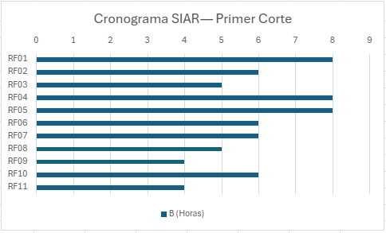

# Cronograma

## 1. Tabla de actividades por semana (Primer Corte)

| Semana | Actividad | Entregable | Responsable |
|--------|-----------|-----------|-------------|
| 1 | Documento de Inicio | `01-inicio/` completo | Mónica Ortiz |
| 2 | Historias de usuario + Casos de uso (Usuarios y Menú) | `02-requerimientos/01-historias.md`, `02-casos-uso.md` | Mónica Ortiz |
| 3 | RF, RNF, Matriz de trazabilidad | `02-requerimientos/03-RF.md`, `04-rnf.md`, `05-trazabilidad.md` | Mónica Ortiz |
| 4 | Diagramas de casos de uso y clases (Usuarios y Menú) | `03-modelado/` | Mónica Ortiz |
| 5 | MER + Diccionario + SQL | `03-modelado/`, `db/schema.sql` | Mónica Ortiz |
| 6 | Revisión + sustentación | Documentación completa + sustentación | Mónica Ortiz |

## 2. Hitos por corte

| Corte | Semana | Peso | Entregable principal |
|-------|--------|------|---------------------|
| 1 | 6 | 30% | Documentación: Inicio + Requerimientos + Modelado de Usuarios y Menú |
| 2 | 11 | 30% | Módulos de Pedidos e Inventario + pruebas |
| 3 | 16 | 40% | Módulos de Facturación y Reservas + despliegue + documentación final |

## 3. Diagrama de Gantt

## 4. Distribución de responsabilidades

El proyecto es desarrollado individualmente por Mónica Ortiz Ossa,
quien asume todos los roles: análisis, diseño, documentación y
modelado durante el primer corte.

## 5. Incrementos (Primer Corte)

| Incremento | Módulo | RF incluidos | Semanas |
|-----------|--------|--------------|---------|
| 1 | Usuarios | RF01–RF06 | 1–3 |
| 2 | Menú | RF07–RF11 | 4–6 |

## 6. Riesgos identificados

| Riesgo | Probabilidad | Impacto | Plan de mitigación |
|--------|-------------|---------|-------------------|
| Falta de claridad en los requerimientos | Media | Alto | Validar cada documento con la profesora |
| Falta de tiempo por otras materias | Alta | Alto | Priorizar tareas críticas |
| Retraso en la entrega de diagramas | Media | Alto | Usar PlantUML y draw.io |
| Cambios de última hora | Media | Medio | Dejar la semana 6 como holgura |

## 7. Evidencia detallada

El detalle completo por requerimiento funcional, caso de uso,
rol/actor, flujo normal y horas estimadas se encuentra en:

📎 [`cronograma-detallado.xlsx`](cronograma-detallado.xlsx)